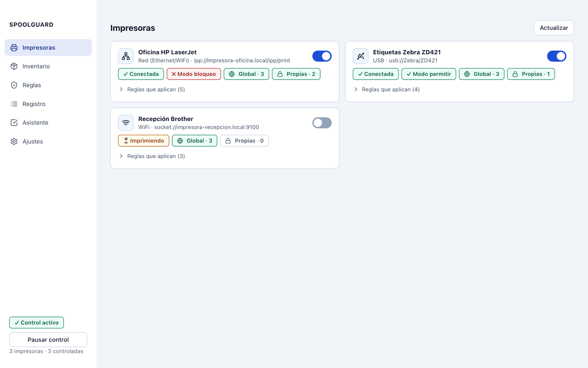
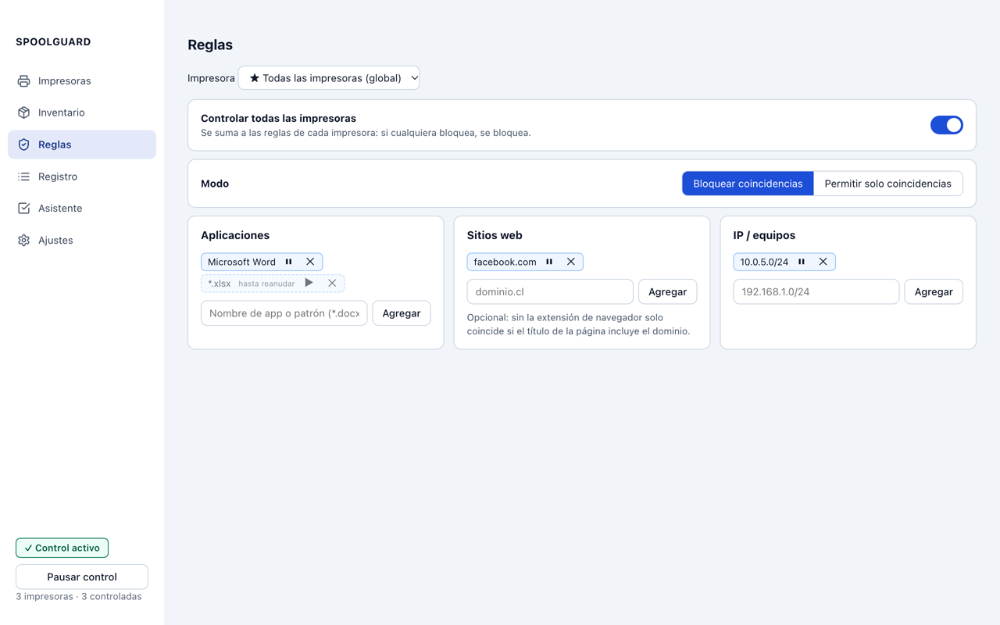
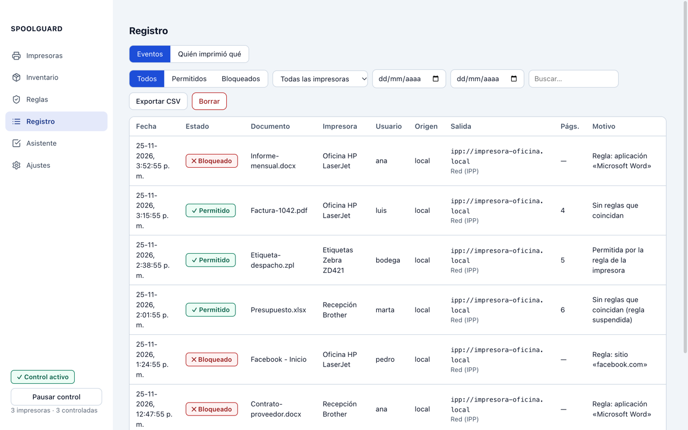

# SpoolGuard

English · [Español](README.md)

SpoolGuard decides what gets printed. It holds every job in the system print queue and releases or cancels it according to rules by application, website and origin computer. It runs as a desktop app (macOS, Windows, Linux) and as a Docker server for a shared network queue.

[](LICENSE)
[](https://github.com/Jul879n/spoolguard/releases/latest)



| Rules | Log |
|---|---|
|  |  |

Screenshots use sample data. The app interface is in Spanish.

## Features

- Rules by application, website and computer (IP or name): block matches or allow only matches.
- Global rule plus per-printer rules; blocking always wins. Rules can be suspended temporarily.
- Pre-print protection: a CUPS filter (macOS/Linux) or a spooler print processor (Windows) makes apps such as Word wait for the verdict before paper comes out ([guide, Spanish](docs/proteccion-previa.md)).
- Browser extension for per-site rules, print log, printer inventory and network discovery.

## Install

Download your file from the [latest release](https://github.com/Jul879n/spoolguard/releases/latest): `.dmg` (macOS, Apple Silicon or Intel), `.msi` (Windows), `.deb` / `.rpm` (Linux), and the extension `.zip`. Installers carry no Windows code-signing certificate and are not Apple-notarized: macOS Gatekeeper and Windows SmartScreen warn on first run. Steps: [docs/instalacion.md](docs/instalacion.md). The app shows its version and checks for updates from Settings; new releases ship minisign signatures and build provenance ([verification guide](docs/firma-releases.md), in Spanish).

## Quick start

On first launch the setup assistant opens: admin permission (pre-print protection), notifications, start at login, global rules, optional browser extension. Then print from a blocked app: it must show as *blocked* in the Log and no paper comes out. See [docs/primeros-pasos.md](docs/primeros-pasos.md).

## Docker server

```
curl -O https://raw.githubusercontent.com/Jul879n/spoolguard/main/deploy/compose.ghcr.yml
CONTROL_ADMIN_PASSWORD='a-long-password' PRINTERS='Office=socket://192.168.1.50:9100' \
  docker compose -f compose.ghcr.yml up -d
# panel: http://127.0.0.1:8080   PCs print to: ipp://SERVER:631/printers/Office
```

Details: [docs/docker.md](docs/docker.md). Ready-made compose files: [`deploy/`](deploy/).

## Status

Verified on real CUPS (macOS, CI Linux) and the Windows spooler (CI); hardware tests on macOS with a USB printer were done by the maintainer. Network IPP printers and TSC TH240 are unconfirmed; the Windows/Linux installers have not been tested on real machines. See the Spanish [README](README.md#estado-de-verificación).

## License

Apache-2.0. Contributions by pull request only ([CONTRIBUTING.md](CONTRIBUTING.md)).
