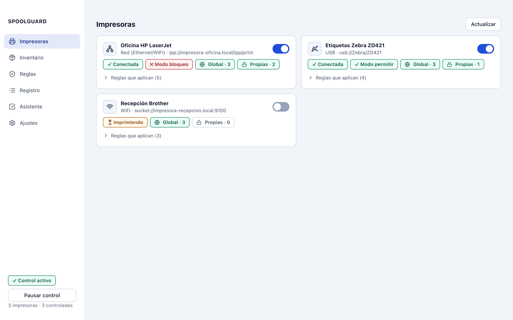
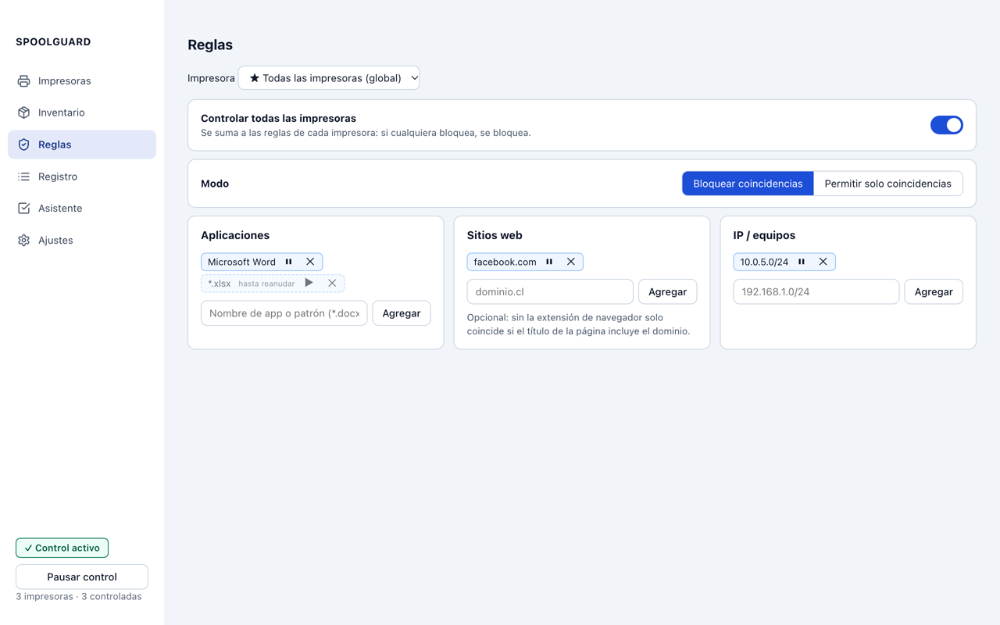
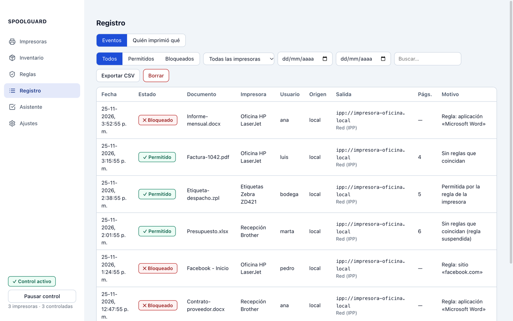
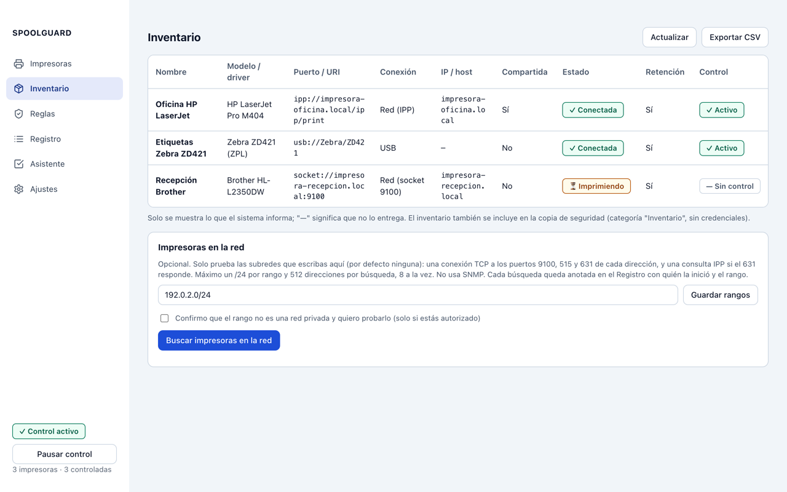
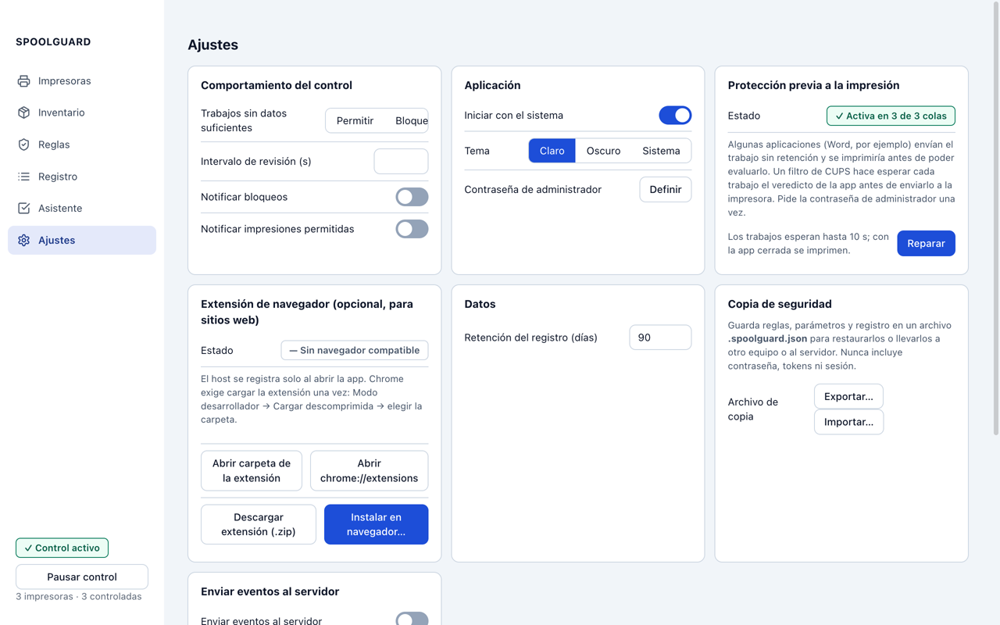
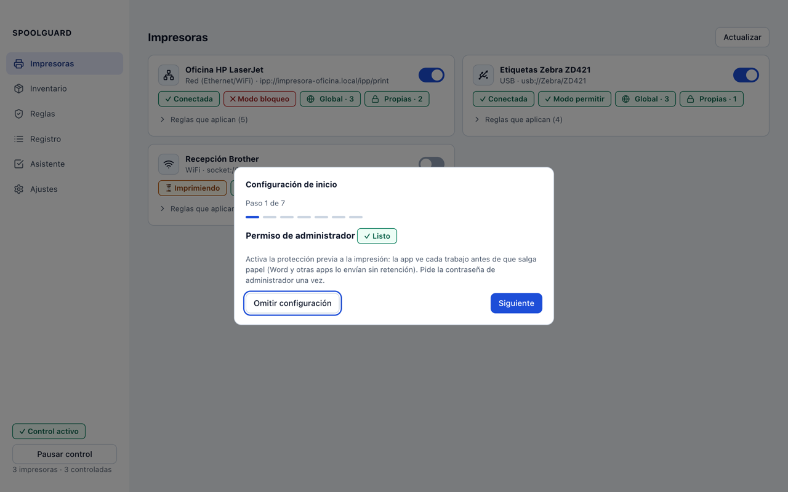
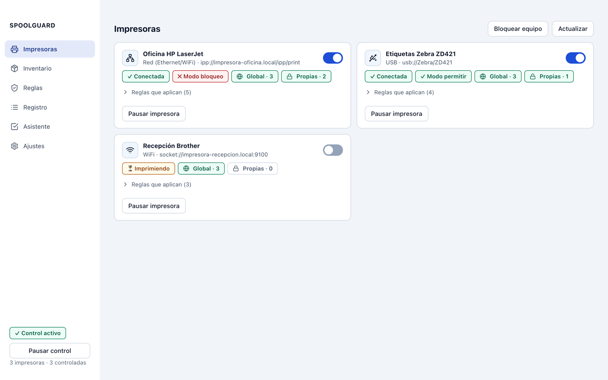

# SpoolGuard

[English](README.en.md) · Español

SpoolGuard controla qué se imprime en una organización: retiene cada trabajo de la cola del sistema y lo libera o lo cancela según reglas por aplicación, sitio web y equipo de origen. Funciona como aplicación de escritorio (macOS, Windows, Linux) y como servidor en Docker para una cola de red compartida.

[](LICENSE)
[](https://github.com/Jul879n/spoolguard/releases/latest)



## Qué hace

- **Reglas por aplicación, sitio web y equipo** (IP o nombre), en modo «bloquear coincidencias» o «permitir solo coincidencias».
- **Regla global y reglas por impresora**: la global se suma a la de cada impresora; si cualquiera bloquea, se bloquea.
- **Suspensión de reglas**: una regla se pausa por un rato o hasta reanudarla, sin borrarla.
- **Protección previa a la impresión**: apps como Word envían los trabajos sin retención; un filtro de CUPS los hace esperar el veredicto antes de que salga papel ([guía](docs/proteccion-previa.md)).
- **Extensión de navegador** para reglas por sitio web ([guía](docs/instalar-extension.md)).
- **Modo servidor (Docker)**: cola IPP compartida y panel web para controlar varios PC ([guía](docs/docker.md)).
- **Registro e inventario**: quién imprimió qué, qué se bloqueó y por qué; inventario de impresoras y búsqueda en la red.

| Reglas | Registro |
|---|---|
|  |  |

| Inventario | Ajustes |
|---|---|
|  |  |

| Asistente de configuración | Panel del servidor |
|---|---|
|  |  |

Las capturas usan datos de ejemplo.

## Videos

**Introducción (~45 s)**

https://github.com/user-attachments/assets/821313d9-f750-49e6-b1d5-b49086383b8d

**Tutorial (~3 min)**

https://github.com/user-attachments/assets/e7e5c7c8-608a-458e-8afa-51280af235d3

Con subtítulos y voz sintética en español (generada localmente); sin música de fondo. Hechos con HyperFrames.

## Instalación rápida

Descarga el archivo de tu sistema desde la [última release](https://github.com/Jul879n/spoolguard/releases/latest):

| Sistema | Archivo |
|---|---|
| macOS Apple Silicon | `SpoolGuard-<versión>-macos-arm64.dmg` |
| macOS Intel | `SpoolGuard-<versión>-macos-x86_64.dmg` |
| Windows | `SpoolGuard-<versión>-windows-x64.msi` |
| Debian / Ubuntu | `SpoolGuard-<versión>-linux-amd64.deb` |
| Fedora / RHEL / openSUSE | `SpoolGuard-<versión>-linux-x86_64.rpm` |
| Extensión de navegador | `SpoolGuard-extension-<versión>.zip` |
| Servidor (Docker) | `ghcr.io/jul879n/spoolguard` |

Los instaladores **no están firmados ni notarizados**: macOS (Gatekeeper) y Windows (SmartScreen) mostrarán un aviso la primera vez. Pasos exactos en [docs/instalacion.md](docs/instalacion.md).

Servidor en Docker:

```
curl -O https://raw.githubusercontent.com/Jul879n/spoolguard/main/deploy/compose.ghcr.yml
CONTROL_ADMIN_PASSWORD='una-clave-larga' PRINTERS='Oficina=socket://192.168.1.50:9100' \
  docker compose -f compose.ghcr.yml up -d
```

## Primeros pasos

La app abre sola el asistente **Configuración de inicio** la primera vez. Guía con capturas: [docs/primeros-pasos.md](docs/primeros-pasos.md).

## Documentación

| Tema | Archivo |
|---|---|
| Instalación por sistema y desinstalación | [docs/instalacion.md](docs/instalacion.md) |
| Primeros pasos | [docs/primeros-pasos.md](docs/primeros-pasos.md) |
| Protección previa a la impresión | [docs/proteccion-previa.md](docs/proteccion-previa.md) |
| Servidor con Docker | [docs/docker.md](docs/docker.md) · referencia completa: [docs/modo-servidor.md](docs/modo-servidor.md) |
| Extensión de navegador | [docs/instalar-extension.md](docs/instalar-extension.md) |
| Red y cortafuegos (impresión directa) | [docs/guia-red.md](docs/guia-red.md) |
| Funcionamiento, persistencia y cierre | [docs/funcionamiento.md](docs/funcionamiento.md) |
| Plan y estado del proyecto | [docs/PLAN.md](docs/PLAN.md) |

Archivos compose listos para usar: carpeta [`deploy/`](deploy/).

## Estado de verificación

Verificado:

- macOS: control de cola con CUPS real; extensión probada en Chrome 157. Pruebas con hardware real hechas por el usuario (2026-11-25): bloqueo y liberación en una impresora USB (Printronix) con Word.
- Linux: CUPS real en CI (`.github/workflows/test.yml`, prueba `core/tests/cups_linux.rs`).
- Windows: spooler probado en un runner real de CI con una impresora virtual (Microsoft Print to PDF) (`core/tests/spooler_windows.rs`).
- Reglas y host de Native Messaging: pruebas unitarias del núcleo, en CI en los tres sistemas.

No verificado:

- Impresora de red con IPP y TSC TH240 en hardware real: sin confirmar.
- La interfaz en un Windows real ni en un Linux de escritorio; los instaladores `.msi`, `.deb` y `.rpm` salen de CI y no se han probado instalados en equipos reales.
- Edge y Firefox con la extensión.
- Impresión directa a la IP de la impresora (puerto 9100): la app no puede controlarla; solo se evita con firewall o VLAN ([docs/guia-red.md](docs/guia-red.md)).
- CUPS no entrega la aplicación de origen del trabajo: solo nombre del documento, usuario y host de origen. Las reglas por aplicación pueden caer en «Trabajos sin datos suficientes».

## Desarrollo

```
npm ci
npx tauri dev
npx tauri build --bundles dmg         # macOS; deb,rpm en Linux; msi en Windows
cargo test -p control-core            # reglas, host nativo, spooler (Windows)
```

Código: `src/` (interfaz), `src-tauri/` (app), `core/` (reglas, CUPS, spooler, host nativo), `extension/` (navegador), `docker/` y `server/` (modo servidor). CI: `test.yml` (pruebas en Ubuntu, Windows y macOS, con CUPS real en Linux) y `release.yml` (instaladores, release e imagen Docker al subir una etiqueta `v*`).

## Contribuir

Solo se aceptan pull requests; ver [CONTRIBUTING.md](CONTRIBUTING.md).

## Licencia

SpoolGuard es software libre bajo la licencia [Apache-2.0](LICENSE). Puedes usarlo, modificarlo y redistribuirlo, también con fines comerciales, conservando el aviso de copyright y la licencia. Ver [NOTICE](NOTICE).
