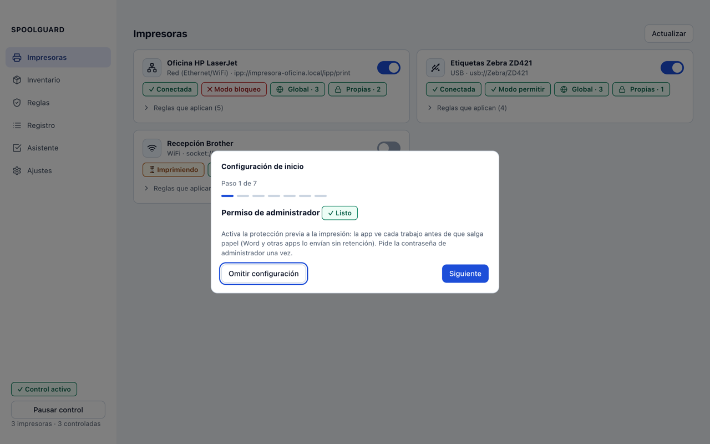

# Configuración de inicio tras instalar SpoolGuard

La app abre sola el diálogo **Configuración de inicio** la primera vez (se reabre con **Asistente**, en la barra lateral).

 Cada paso muestra su estado real.

1. **Permiso de administrador (protección previa).** Ajustes → «Protección previa a la impresión» → Activar. Pide la contraseña de administrador una vez (macOS: diálogo del sistema; Linux: `pkexec`; Windows: UAC). En macOS/Linux instala un filtro de CUPS y en Windows un print processor (`spoolguardpp`) en las colas; en ambos casos cada trabajo espera el veredicto de la app antes de enviar datos a la impresora. Sin esto, apps como Word (`job-hold-until=no-hold`) pueden imprimir antes de ser evaluadas y, en Windows, un trabajo podría salir durante la ventana en que la cola se reanuda para liberar otro.
2. **Notificaciones.** macOS: Ajustes del Sistema → Notificaciones → SpoolGuard → Permitir. La app no puede comprobarlo.
3. **Iniciar con el sistema.** Activar para que el control funcione desde el arranque.
4. **Reglas globales.** Reglas → agregar aplicaciones, sitios o equipos a bloquear (o permitir solo ciertos).
5. **Extensión de navegador (opcional).** Ajustes → «Instalar en navegador…». Chrome: cargar la carpeta una vez en `chrome://extensions` con Modo desarrollador.
6. **Contraseña de administrador de la app (opcional).**
7. **Prueba.** Imprime desde una app bloqueada: debe verse «bloqueado» en Registro y no salir papel; luego desde una permitida.

Servidor (Docker): la protección previa ya viene incluida en la imagen; ver [docker.md](docker.md) y [proteccion-previa.md](proteccion-previa.md).
